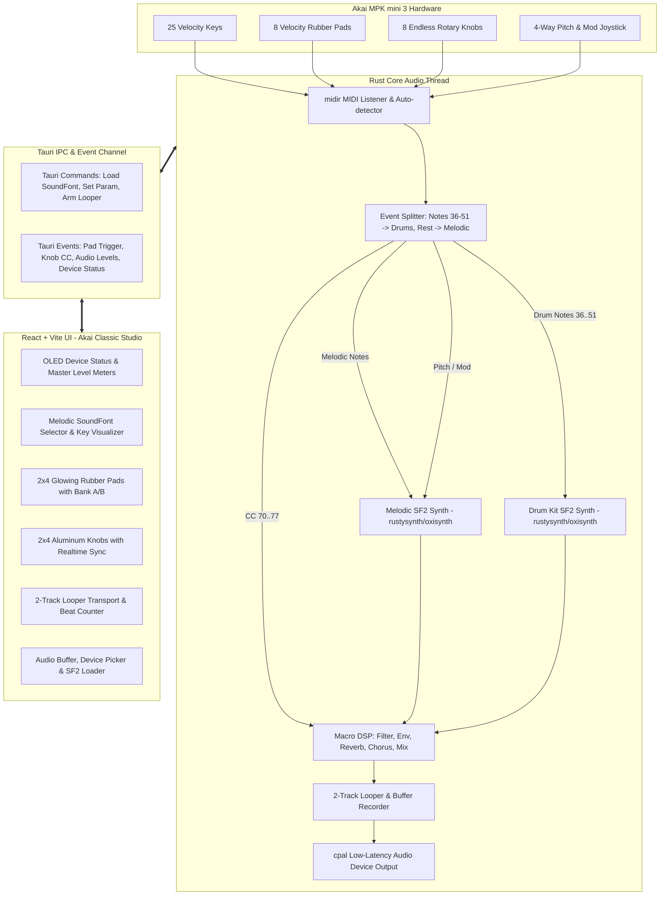

# MiniStation — Master Implementation Plan

> **Lightweight Open-Source Sound Module & Performance Workstation for the Akai MPK mini 3**
> Built with Rust + Tauri v2, pure Rust SoundFont synthesis, and a React/TypeScript Akai Classic Studio UI.

---

## 1. System Architecture

---

## 2. Implementation Tickets Roadmap

Each task is defined in its own self-contained ticket file in the `tasks/` directory:

| Ticket | Task Title | Target Files | Status |
| :--- | :--- | :--- | :--- |
| **[TASK-001](file:///Users/ruben.gerits/Developer/sources/mpc-app/tasks/001-project-scaffolding.md)** | Project Scaffolding (Tauri v2 + Rust + Bun/React) | `package.json`, `Cargo.toml`, `src-tauri/Cargo.toml`, `vite.config.ts` | `DONE` |
| **[TASK-002](file:///Users/ruben.gerits/Developer/sources/mpc-app/tasks/002-midi-engine-routing.md)** | Native MIDI Device Discovery & Auto-Routing | `src-tauri/src/midi.rs`, `src-tauri/src/router.rs` | `DONE` |
| **[TASK-003](file:///Users/ruben.gerits/Developer/sources/mpc-app/tasks/003-soundfont-synthesis-engine.md)** | Pure-Rust Dual SoundFont Synthesis & Audio Stream | `src-tauri/src/audio.rs`, `src-tauri/src/synth.rs` | `DONE` |
| **[TASK-004](file:///Users/ruben.gerits/Developer/sources/mpc-app/tasks/004-curated-soundfonts-assets.md)** | Curated Open-Source SoundFonts & Asset Loader | `src-tauri/assets/soundfonts/`, `src-tauri/src/assets.rs` | `DONE` |
| **[TASK-005](file:///Users/ruben.gerits/Developer/sources/mpc-app/tasks/005-dsp-macro-knob-controls.md)** | Macro DSP Controls & CC Mapping Chain | `src-tauri/src/dsp.rs` | `DONE` |
| **[TASK-006](file:///Users/ruben.gerits/Developer/sources/mpc-app/tasks/006-quick-looper-recorder.md)** | 2-Track Quick Looper & WAV Exporter | `src-tauri/src/looper.rs`, `src-tauri/src/wav_export.rs` | `DONE` |
| **[TASK-007](file:///Users/ruben.gerits/Developer/sources/mpc-app/tasks/007-tauri-ipc-state-bridge.md)** | Tauri IPC State, Commands & Realtime Events | `src-tauri/src/commands.rs`, `src-tauri/src/main.rs` | `DONE` |
| **[TASK-008](file:///Users/ruben.gerits/Developer/sources/mpc-app/tasks/008-frontend-akai-classic-layout.md)** | Frontend Shell: Akai Classic Studio Chassis | `src/App.tsx`, `src/components/Header.tsx`, `src/components/Meter.tsx` | `DONE` |
| **[TASK-009](file:///Users/ruben.gerits/Developer/sources/mpc-app/tasks/009-frontend-pads-and-keys.md)** | Frontend 2x4 Rubber Pads & Instrument Selector | `src/components/PadMatrix.tsx`, `src/components/KeyboardPreview.tsx` | `DONE` |
| **[TASK-010](file:///Users/ruben.gerits/Developer/sources/mpc-app/tasks/010-frontend-knobs-and-looper.md)** | Frontend Rotary Knobs & Looper Transport | `src/components/KnobRack.tsx`, `src/components/LooperBar.tsx` | `DONE` |
| **[TASK-011](file:///Users/ruben.gerits/Developer/sources/mpc-app/tasks/011-audio-midi-settings-dialog.md)** | Audio/MIDI Configuration & Custom SoundFont Dialog | `src/components/SettingsModal.tsx`, `src/components/SoundFontManager.tsx` | `TODO` |
| **[TASK-012](file:///Users/ruben.gerits/Developer/sources/mpc-app/tasks/012-end-to-end-integration-polish.md)** | End-to-End Latency Verification, Build & README | `README.md`, integration tests, release packaging | `TODO` |

---

## 3. Development Guidelines

1. **One Task at a Time**: Complete and verify each ticket before advancing to the next.
2. **Deterministic Builds**: Use pure Rust SoundFont decoders (`rustysynth`) to avoid dynamic C library linkage issues (`libfluidsynth.dylib/so`).
3. **Low-Latency Priority**: Keep the audio callback lock-free using atomic queues or lock-free ring buffers (crossbeam-channel / triple-buffer).
